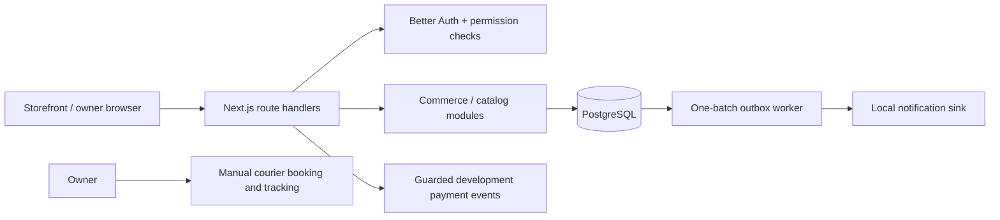

# System Architecture

**Purpose:** authoritative current structure and architectural decisions. **Status:** current local implementation contract; real-provider and commercial release gates remain open. **Updated:** 2026-11-14. **Related:** [PRD](PRD.md) · [DATA](DATA.md) · [API](API.md) · [SECURITY](SECURITY.md) · [DELIVERY](DELIVERY.md) · [Phases](Phases.md)

## Implemented structure

One merchant, BDT, Bangladesh, one initial stock location. A Next.js App Router/TypeScript modular monolith uses PostgreSQL for durable commerce, Better Auth for password/session/TOTP/recovery codes, and an owner-only console. Locked versions are in package-lock.json (Next 16.4.6, React 19.3.1, Better Auth1.7.23); verified local runtime is Node 24.22.3/PostgreSQL 18.6. No hosting/account/service has been assumed or provisioned.

Server modules own prices, locks, commitments, funding/refund capacities and transitions. UI components carry selected identities and show eligibility; they never grant permission or set paid stock. Browser filters/search/sort operate on the small published catalog; PostgreSQL/search-service search remains a measured future option, not current architecture. Public media is sourced URL/alt/order with browser previews; object storage/native uploads are not implemented. Native claims from the former proposed stack are superseded.

## Boundaries, flows and transactions

Catalog modules separate product family, variant, exact model fit and structured source-backed specs. Owner editor/inventory/order/COD components are independent from shared customer/access/money presentation. The money-input boundary parses BDT strings exactly; server/API/database use integer poisha.

Checkout locks SKUs and discount, reprices, captures snapshots, holds inventory, creates order/attempt and outbox atomically. Payment events verify local input, dedupe and either commit the same hold or enter reconciliation without fulfillment. Cancellation releases only predispatch holds; refunds reserve global funding and exact unit capacity under transaction locks. Return receipt/inspection/disposition and payout are separate operations. COD collection funds customer payment; remittance later matches courier receivables. Network/provider calls do not occur while holding commerce transactions open. Owner detail fetch locks its selected order for a consistent short transaction; stale UI actions still revalidate.

API is consolidated /api/store, detailed in API. Auth endpoints are library-owned. The database outbox worker runs one batch via notifications:run, with durable failures and local-only template rendering. Automatic scheduling/real delivery is a production task. Manual courier is valid implemented scope.

## Components and deployment

`src/app` contains routes; `src/components` holds customer, access and owner task workspaces; `src/modules/commerce` owns money/stock/order transitions; `src/modules/catalog` owns typed fit/spec/media edits; `src/modules/store` reads catalog; `src/lib` owns DB/auth/money; `db/migrations`, `scripts` and `tests` reproduce setup and evidence. Customer/admin use the same commerce database and domain code. Temporary UI state cannot substitute for committed records.

Private order/account/admin APIs use no shared cache. Published catalog content can later be cached with invalidation, but currently client fetches authoritative API data. Production topology would be TLS web hosting + private PostgreSQL + worker + reviewed external adapters; it is not deployed. Dev/test/prod credentials/databases must be isolated.

## Decisions

| ADR  | Current decision                                         | Tradeoff/status                                                                     |
| ---- | -------------------------------------------------------- | ----------------------------------------------------------------------------------- |
| A-01 | Next.js/TypeScript/PostgreSQL modular monolith           | Confirmed user baseline, implemented; simple transactions over independent services |
| A-02 | Small catalog browser search/filter/sort                 | Implemented; scale/relevance limits documented, database search future              |
| A-03 | Provider-independent state + guarded development adapter | Local tested only; bKash/SSLCOMMERZ selection/onboarding/sandbox open               |
| A-04 | Manual courier booking/tracking                          | Implemented; automation not required for local operation                            |
| A-05 | Better Auth PostgreSQL + owner MFA                       | Implemented/tested; real password-reset/recovery delivery still open                |
| A-06 | PostgreSQL outbox + one-batch worker/local sink          | Implemented/tested; scheduling/real notification adapter before commercial release  |

Earlier proposals for managed auth/storage/search and alternative REST endpoints are superseded, not parallel current contracts. Useful prior alternatives are preserved in Git `20c856b` and Memory history. Sources accessed2026-11-14: installed Next.js current docs `node_modules/next/dist/docs`, https://nextjs.org/docs/app, https://better-auth.com/docs/integrations/next, https://better-auth.com/docs/plugins/2fa, https://www.postgresql.org/docs/current/. Provider discovery sources https://www.bkash.com/business and https://developer.sslcommerz.com/ do not establish eligibility, endpoints, fees or access.

Risks/release work: unverified real adapters, merchant approval, approved policies/rates/coverage/battery acceptance, product-source quality, native uploads if later authorized, operational monitoring/backup/retention and legal/tax/invoice review. Growth should follow measurement; no microservices/multiwarehouse dependency was added.
