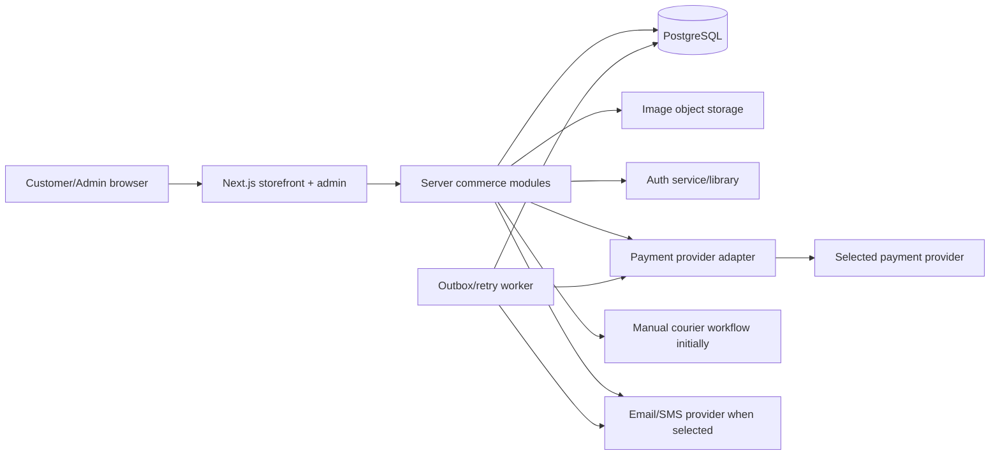

# System Architecture

**Purpose:** authoritative technical structure and decisions. **Status:** modular monolith implemented and locally verified; external deployment unverified. **Updated:** 2026-11-14. **Related:** [PRD](PRD.md) · [DATA](DATA.md) · [API](API.md) · [SECURITY](SECURITY.md) · [DELIVERY](DELIVERY.md) · [Phases](Phases.md).

## Goals and recommendation

One merchant, modest initial complexity, developer knows Next.js, secure commerce state, Bangladesh BDT and provider uncertainty. Recommend modular monolith: Next.js App Router + TypeScript, PostgreSQL, one deployable web application and background worker/outbox process when needed. Use a supported managed Postgres/auth/storage/hosting service only after cost, region, backup, security and account decisions; self-hosting also viable but requires explicit operations capacity. No vendor/account assumed.

Stack proposal: Next.js App Router, TypeScript, schema validation (e.g. Zod), PostgreSQL with migrations and transaction isolation/conditional updates; auth library/provider with MFA and role claims validated server-side; object storage for images; Postgres full-text/trigram initially; durable database outbox plus scheduled worker/managed queue for retries. Search service, Redis, separate backend only when measured need justifies. Official Next.js App Router docs accessed 2026-11-14: https://nextjs.org/docs/app (docs page says updated 2026-03-25). PostgreSQL official docs: https://www.postgresql.org/docs/ (verify chosen major version before implementation). Implementation baseline as researched 2026-11-14: Node.js 24 LTS (Node 22 entered EOL on 2026-11-11 per https://nodejs.org/en/about/previous-releases) and PostgreSQL 18 current supported major (https://www.postgresql.org/docs/current/). Next.js 16 installation docs list Node 20.9 minimum (https://nextjs.org/docs/app/getting-started/installation); choose Node 24 for current LTS support. Versions are locked in package-lock.json and locally build-verified.

Reuse framework, database, managed auth/storage and official provider SDKs where reviewed; custom-build catalog compatibility, stock ledger, order state machine, reconciliation and admin workflows. Do not outsource core invariants to browser or payment redirect.

## Context and components



Modules: presentation routes; catalog/search/compatibility; inventory ledger/reservations; checkout/order; payment/refund adapter; fulfillment/shipment/COD; returns/warranty; notifications/outbox; reports; identity/authorization/audit. PostgreSQL owns durable business state. Browser state/cart cache is convenience only; server revalidates. Provider and courier are external systems, never authoritative for local state transitions without verification/evidence.

Transaction boundaries: checkout locks/checks SKU stock, creates order snapshot, reservation, discount redemption and payment attempt atomically; provider call after commit via outbox/saga; verification event idempotently updates payment and order/reservation in transaction. Inventory movements append-only. Refund request/approval and provider call staged; webhook/poll reconciliation updates state. Fulfillment transition and shipment/tracking event transaction; COD collection and remittance separate records. Notifications outbox retries without blocking commerce writes.

Flows: checkout creates reservation then online hosted flow or COD confirmation; payment verified server-to-server. Dispatch records shipment, later delivery; COD collection/remittance reconcile independently. Cancellation checks fulfillment/payment state then releases stock and creates refund workflow. Late/repeated event dedupes and routes to reconciliation when invariant conflict. Never hold a DB transaction open over network calls.

## Deployment, caching, structure

Topology proposal: browser → TLS hosting/CDN → Next.js server → private Postgres; worker and object storage; provider webhook route. Public published catalog can use short-lived cache with explicit invalidation; cart/checkout/order/admin/account/payment pages and APIs private/no shared cache. No PII in CDN cache. Deploy environments isolated. Background processing initially DB outbox/worker, not distributed broker.

```text
src/app/(store)/...  src/app/admin/...
src/modules/{catalog,inventory,checkout,orders,payments,fulfillment,returns,customers,notifications,reports}/
src/lib/{auth,db,validation,money,time,observability}/
src/adapters/{payments,courier,notifications}/
db/migrations/  tests/{unit,integration,e2e}/
```

## Architecture decisions

| ADR  | Context/options                               | Recommendation/tradeoff                                                                                      | Status / requirements   |
| ---- | --------------------------------------------- | ------------------------------------------------------------------------------------------------------------ | ----------------------- |
| A-01 | Next.js modular monolith vs separate services | Next.js + TS + PostgreSQL; matches experience and enables transactional invariants, less independent scaling | Proposed; all           |
| A-02 | Search engine vs database                     | Postgres search first; simpler, later relevance limits possible                                              | Proposed; CAT-01        |
| A-03 | Provider selection                            | Adapter boundary; evaluate bKash and SSLCOMMERZ only after onboarding/docs/sandbox access                    | Open; PAY-01            |
| A-04 | Courier automation                            | Manual booking/tracking first; avoids unverified API dependency                                              | Proposed; FUL-01        |
| A-05 | Auth                                          | managed/provider or maintained library supporting MFA; choose after hosting/privacy/cost review              | Open; ADM-01            |
| A-06 | Background jobs                               | DB outbox + worker first, durable retry; add queue if load/operations justify                                | Proposed; PAY-01/OPS-01 |

Official provider research accessed 2026-11-14: bKash describes online business solutions including gateway/API and merchant signup, but eligibility/contract/access/flows remain unverified: https://www.bkash.com/business and https://www.bkash.com/en/business/merchant. SSLCOMMERZ developer docs are provided at https://developer.sslcommerz.com/; exact endpoints, sandbox access, methods, fees, settlement/refund behavior need merchant-specific verification before selection. This is not provider approval or API contract. Battery/power-bank shipping restrictions and carrier acceptance require selected courier confirmation. Evolution: account history/discounts → measured search/notification efficiency → only then independent services or multiple locations if proven need. Risks: provider onboarding delays, inaccurate specs, staff access, backup ownership, Bangladesh delivery variation.

## Reconciled local and external dependency boundary

The app starts locally from placeholder environment configuration plus local PostgreSQL, fictional fixtures, owner bootstrap and a development-only mail sink. Test payment adapter is deterministic and explicitly environment-gated; production startup must reject test-adapter success mode. Provider sandbox access proves only selected provider behavior; it is not needed to implement catalog, transactional order core, manual courier workflow, or test adapter. Real payment/courier/OTP services remain adapters with no invented endpoint; commercial activation is independently gated by merchant approval, verified provider docs/configuration, courier coverage/rates/restrictions, owner policies and production operations. See dependency classification in [DELIVERY](DELIVERY.md).

## Implemented decisions — 2026-11-14

The user implementation instruction confirms Next.js/TypeScript/PostgreSQL baseline. Locked versions: Next.js16.4.6, React19.3.1, Better Auth1.7.23, pg8.23.1. Execution used Node24.22.3 and isolated PostgreSQL18.6 via embedded-postgres18.6.0-beta.19. Auth is self-contained PostgreSQL Better Auth with MFA; search/filter/sort is currently in the browser over the small published catalog (database/external search remains measured evolution). The worker is a one-batch PostgreSQL outbox script, local notification sink only. Courier booking is manual. Payment simulation is an explicitly guarded development adapter in the API boundary; the durable domain module accepts verified events, while a real-provider adapter remains a release dependency. Media is URL-based with alt text, not an object-upload service. No Supabase/Vercel account or hosted infrastructure was provisioned. Root AGENTS.md was generated by Next.js at dev startup; its current-version documentation guidance was read.
