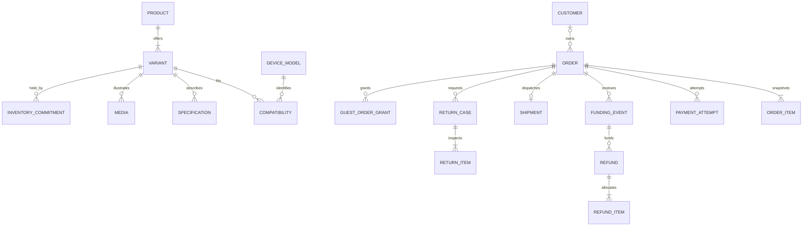

# Data Model and Business Invariants

**Purpose:** authoritative entities, statuses and stock/money integrity. **Status:** current local implementation contract; real-provider and commercial release gates remain open. **Updated:** 2026-11-14. **Related:** [PRD](PRD.md) · [API](API.md) · [SECURITY](SECURITY.md) · [Architecture](Architecture.md) · [DELIVERY](DELIVERY.md)

## Schema and relationships

Exact fields, keys/checks/indexes are versioned under [migrations](../db/migrations/001_initial.sql) through013; Better Auth separately generates identity/session/account/TOTP/rate-limit tables. The app stores customer.auth_subject, not payment credentials. One initial stock location is primary. No marketplace or multiwarehouse schema is assumed.

| Entity group                                            | Important fields/relationships and integrity                                                                                                                                                                                |
| ------------------------------------------------------- | --------------------------------------------------------------------------------------------------------------------------------------------------------------------------------------------------------------------------- |
| products/categories/brands                              | stable UUIDs, unique slug/name as declared, published flag; product family is not a sellable SKU                                                                                                                            |
| variants                                                | product_id, unique SKU, label, integer price_minor, active, location and balance counters; SKU rename retains variant ID                                                                                                    |
| device_models/compatibility                             | brand/model/model_number and variant_id↔device_model_id with source/verified_at; fit is exact SKU, never implied for sibling variants                                                                                       |
| specifications/media                                    | per-variant typed attribute/value/source; unknown unedited attributes preserved, explicit removals validated; media URL/alt/sort_order, no native upload                                                                    |
| shopping_sessions/cart_items/grants                     | hashed credential, expiry; persisted variant quantities; grant session/order, expiry/revocation; auth identity separate from delivery phone                                                                                 |
| orders/order_items                                      | recipient/address and immutable name/SKU/label/price/spec/compatibility/policy snapshots; item subtotal/discount/delivery/total; later catalog/policy edits cannot alter them                                               |
| inventory_commitments/movements                         | order/variant/positive quantity, kind/status/expiry; unique source command; movement quantity/physical/sellable/quarantine deltas, actor/reference/reason                                                                   |
| checkout/command/http results                           | unique key, request hash, session/order or command/result; changed-key payload conflicts; raw credentials not saved in command results                                                                                      |
| payment_attempts/provider_events                        | order, provider/ref, amount/currency/status/verified_at; deduplicated provider+event; funding only after verification; safe metadata not secrets                                                                            |
| funding_events/refunds/payout_attempts                  | immutable verified amount/source/ref; refund amount/status/item/shipping capacity, funding FK; payout status/ref/evidence; COD collection can fund refund independently of courier remittance                               |
| unit/refund allocations                                 | immutable gross/discount per purchased unit; exact refund-to-unit links prevent quantity/odd-poisha discount reuse after failed partial payout                                                                              |
| shipments/returns/return_items                          | one shipment/order MVP; tracking/status; requested item quantities bounded by purchase; received_at, inspection, disposition and actor; partial returns supported, receipt accepts declared authorized quantities as a unit |
| warranty_claims                                         | order item, reason/status/resolution; reviewed terms, no invented warranty duration                                                                                                                                         |
| cod_collections/remittances/allocations                 | exact verified customer collection once/order; distinct courier batch/reference and bounded matches; outstanding remains visible                                                                                            |
| discounts/redemptions                                   | fixed amount, dates, active, usage_limit/used_count; row lock and atomic use; cancellation does not return usage; percentage discounts outstanding                                                                          |
| outbox/local_deliveries/templates/audit/support/content | durable retry fields, dedupe, safe payload; local-only sink; plain text templates/content with versions; actor/reason/evidence audit and order-scoped notes                                                                 |

Index real lookup paths: product/category/published, SKU unique, compatibility by model/variant, order customer/date and status/date, commitments live variant, funding/refunds/order, exact purchased unit links, recovery order/date, outbox state/next_attempt, media variant/order, support order/date. Foreign keys protect referenced snapshots and ledgers. Archive products; don't erase referenced purchase records.

## Mobile-accessory examples (fictional)

Clear Case SKU CASE-Z-CLEAR fits only Fictional Phone Z; sibling CASE-Q-CLEAR fits Phone Q even if both share a family. Charger CHG-30C separately declares USB-C, USB Power Delivery, maximum30W, 5V/3A,9V/3A,15V/2A and cable inclusion from a recorded source. Connector shape proves neither protocol nor power. Structured validation rejects a supplied voltage/current profile above declared maximum. Owners can edit typed connector/protocol/power/profile/cable fields; the UI does not discard unknown saved specification values during another edit.

## Money, dates and snapshots

Database/API BDT amounts are nonnegative safe integer poisha. Owner inputs accept decimal BDT text with at most two digits: 1850.50→185050. Parse via digit/BigInt arithmetic, reject scientific notation, grouping, negative/excess precision/out-of-range values; supported maximum is Number.MAX_SAFE_INTEGER poisha. Display splits integer whole/fraction, without float currency calculation. Fixed discount allocation uses deterministic largest remainder and persisted per-unit allocations. Tax rates are not invented/configured. UTC instants display/report Asia/Dhaka. Normalize delivery phone01 to+880; validate Bangladesh workflow. Contact address records recipient, phone, district/city/area/street/landmark; actual courier requirements remain a commercial prerequisite.

## Stock conservation

`physical_on_hand = variants.sellable_qty + variants.quarantined_qty`; `available = sellable_qty - committed_qty`. committed_qty counts every active reservation and paid/COD-confirmed commitment. Commitments use kind reservation/committed and status active/dispatched/released/expired; conceptual reservation→allocation is a kind change on the same active row.

| Event                             | Preconditions/actor                                       | Atomic effect                                                                                             |
| --------------------------------- | --------------------------------------------------------- | --------------------------------------------------------------------------------------------------------- |
| Receipt                           | owner, counted positive quantity/reason/key               | increase sellable and physical, append movement once                                                      |
| Adjustment                        | owner, count reason/key                                   | signed sellable/physical correction; never below committed                                                |
| Checkout reserve                  | server, all SKU availability                              | lock in stable order, create active reservation and increment committed counter atomically                |
| Payment verified/COD confirmed    | verifier/owner, valid eligible hold                       | change kind to committed, clear expiry; available unchanged, no gap                                       |
| Dispatch                          | owner, confirmed committed stock/tracking                 | decrement sellable and committed together, close hold and append unique dispatch; physical decreases once |
| Approved predispatch cancellation | owner, unshipped                                          | release live hold once; committed decreases; sellable/physical unchanged; no receipt                      |
| Return receipt                    | owner, authorized declared quantities physically received | quarantine and physical increase once; available unchanged                                                |
| Sellable inspection/restock       | owner, received quarantined goods                         | quarantine decreases, sellable increases by same quantity, total physical unchanged                       |
| Damaged/unavailable inspection    | owner                                                     | remains quarantined/unavailable; refund cannot restock it                                                 |
| Writeoff                          | owner, inspected quarantined goods/reason                 | quarantine and physical decrease; no sellable increase                                                    |

Online reservations expire only after safe authoritative payment checks; unresolved attempts retain holds. COD uses independent confirmation rules, never the online timer. Repeat keys/events are no-ops or replay saved results. Two buyers cannot reserve the same final unit; paid stock stays unavailable until dispatch or valid release.

## Refund eligibility branches and capacity

1. **Unshipped cancellation:** owner explicitly approves cancellation before dispatch. All eligible purchased unit allocations may be refunded against verified funding without return/receipt/inspection. Cancellation only releases commitment; refund only changes money state.
2. **Late payment:** cancelled/expired hold success records verified funding and reconciliation, not fulfillment. An unshipped order not already cancelled must first receive explicit owner-approved cancellation. Then the same no-return refund path applies. Delayed failed/pending events cannot overwrite verified reconciliation or rebind its provider reference.
3. **Delivered/previously dispatched return:** quantity capacity comes from authorized, actually received and inspected return items. It is independent of whether inspection makes them sellable, quarantined or written off. A cancellation flag cannot bypass the dispatched-history guard.

All branches share funding/order locks and exact unit/shipping allocation caps. `refundable funding = verified funding - succeeded refunds - outstanding approved/submitting/pending/unknown/reconciliation commitments`. Quantity capacity also subtracts succeeded and outstanding unit links. Reserve before external/manual submission. Timeout/unknown retains capacity; retry/reconcile the same outcome/reference. Only definitive failure releases exact reserved units; success consumes capacity. Shipping is capped across all funding sources for the order. COD funding requires verified customer collection; unpaid COD cancellation has nothing to refund. Courier remittance is a separate receivable event, not refund authorization or automatic payout.

## Canonical state transitions

| Domain         | Valid transitions and effects                                                                                                                                                                                                                    |
| -------------- | ------------------------------------------------------------------------------------------------------------------------------------------------------------------------------------------------------------------------------------------------ |
| Order          | pending_payment or awaiting_cod_confirmation→confirmed→processing→completed; eligible unshipped→cancellation_requested→cancelled; rejection restores recorded prior state; owner may approve direct unshipped cancellation                       |
| Payment        | created→pending→succeeded/failed/expired; late/conflicting verified result→reconciliation_required; succeeded/reconciled funding cannot be downgraded by delayed failure/pending                                                                 |
| Shipment       | dispatched→delivered or delivery_failed; failure→retry_scheduled/return_to_origin; retry→delivered/failure; RTO→returned_to_store; domain preconditions enforced                                                                                 |
| Return         | requested→authorized/rejected; authorized/in_transit→received; item inspection resolves case when complete; item disposition remains separate                                                                                                    |
| Refund         | approved→pending after submission; pending/unknown→succeeded/definitive failed/unknown through evidence; reserved units survive unknown; requested/submitting/reconciliation states are supported schema states, not arbitrary client-set values |
| Payout attempt | pending/unknown→succeeded/failed after verification; no HTTP-timeout release                                                                                                                                                                     |
| Warranty       | requested/reviewing/approved→resolved or rejected with resolution; no automatic refund/stock side effect                                                                                                                                         |
| Outbox         | pending/failed→delivered through local worker; failure increments attempts and schedules retry                                                                                                                                                   |

Retention/deletion remains a reviewed business/legal schedule. Verify identity for privacy requests, minimize personal data and anonymize eligible profiles without destroying required order/payment records. No legal duration is assumed.

Legacy order guest_token columns remain unused by HTTP authorization; the current credential is the shopping-session grant flow. They do not introduce an alternative token/link permission contract. Media sort_order is additive migration013; no owner/business data reset is required.
