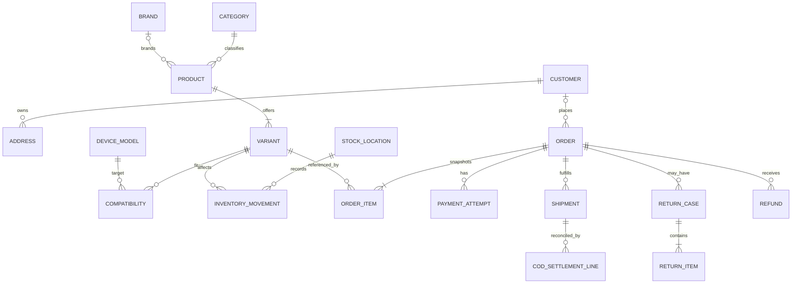

# Data Model and Business Invariants

**Purpose:** authoritative entities, relationships, canonical states and integrity. **Status:** implemented local schema and invariants; see DELIVERY for evidence. **Updated:** 2026-11-14. **Related:** [PRD](PRD.md) · [API](API.md) · [SECURITY](SECURITY.md) · [Architecture](Architecture.md) · [Phases](Phases.md).

## Model

**Launch dictionary:** CustomerProfile (optional link to AuthIdentity; phone not identity); Address (structured recipient location); Product (family/title/content/category/brand); Variant/SKU (sellable attributes, SKU, price, active state); DeviceModel (brand/model/model number); Compatibility (variant↔model, fit notes/source); Specification (typed fields by category); Media; StockLocation; InventoryMovement (immutable signed quantity/reason/reference/actor); Reservation (variant/order/qty/expiry/status); Cart/CartItem; Order (totals, address/policy snapshots); OrderItem (name/SKU/unit price/discount/cost and spec snapshots); PaymentAttempt; ProviderEvent (dedup key/raw safe metadata); Refund/RefundItem; Shipment/TrackingEvent; ReturnCase/ReturnItem; WarrantyClaim; Discount/Redemption; CODCollection; CourierSettlement/line; AuditEvent; NotificationDelivery. Future: multiple warehouses, supplier procurement, loyalty, accounting ledger, marketplace seller.

## Variant and specification examples

Illustrative only. Product family “Clear Case for Phone Z”; SKU `CASE-Z-CLEAR` is compatible only with Phone Z model 2025, while sibling `CASE-Q-CLEAR` fits Phone Q. Compatibility is per SKU; family-level labels cannot imply universal fit. Charger SKU `CHG-30C` has USB-C output, USB Power Delivery up to 30 W, supported voltage/current profiles recorded from verified label/manufacturer source, cable inclusion recorded separately. Connector shape does not prove protocol, power, or device compatibility. Structured filterable fields: connector input/output, protocol list, max output W, profile tuples, cable included/type/length, battery capacity Wh/mAh and voltage basis where known, plug type, model identifiers, case material/color. Store source and verification date for critical claims.

## Relationships, keys, constraints, queries

Use immutable UUID primary keys, unique normalized SKU, unique provider event `(provider,event_id)` and transaction reference, unique `(variant,device_model)` compatibility, FK restrictions for referenced historical rows. Product deletion is archive; order snapshots survive catalog edits. Query indexes: published products/category/brand; normalized SKU unique; compatibility `(device_model_id,variant_id)` and reverse `(variant_id,device_model_id)`; order `(created_at,status)`, guest lookup token hash unique, customer history `(customer_id,created_at)`; reservation `(variant_id,status,expires_at)`; payment provider reference unique; shipment tracking/order; settlement unmatched status/date; notification retry status/next_attempt.

| Area          | Integrity rule                                                                                                                                                                                                                                                                                                                                |
| ------------- | --------------------------------------------------------------------------------------------------------------------------------------------------------------------------------------------------------------------------------------------------------------------------------------------------------------------------------------------- |
| Money         | BDT integer poisha, nonnegative unless explicit signed ledger movement; deterministic half-up rounding only at defined tax/percentage boundary; line totals sum exactly to order total.                                                                                                                                                       |
| Time          | UTC instants in storage; render/report Asia/Dhaka; date-only policy validity remains local business date.                                                                                                                                                                                                                                     |
| Phone/address | Normalize Bangladesh numbers to canonical country-code form after validation; retain user display form only as needed. Address fields: recipient, phone, district, city/upazila, area, street/house, landmark, delivery note; verify actual provider/courier requirements.                                                                    |
| Snapshots     | Order item description/SKU/price/discount and delivery fee, destination, terms/policy version captured; later edits do not mutate historical purchase.                                                                                                                                                                                        |
| Inventory     | Variant-level available = on_hand − active_reservations − other committed allocations. Atomic conditional allocation prevents below-zero availability. Every adjustment has actor/reason; movement history append-only.                                                                                                                       |
| Reservation   | Online checkout reserves at order creation until configured expiry; payment success converts the reservation to a committed hold without releasing availability; failed/expired releases only after authoritative payment check/reconciliation. COD reservation follows explicit independent confirmation/expiry policy; never online expiry. |
| Coupon        | Validate and reserve redemption atomically with checkout; release on cancellation only under configured rules; cap across concurrent orders.                                                                                                                                                                                                  |
| Payment       | Provider events idempotent; preserve event and processing outcome. Verify amount/currency/order association against provider, handle repeated/out-of-order events.                                                                                                                                                                            |
| Late payment  | Success after cancellation/expiry becomes reconciliation-required; do not fulfill or silently discard funds; alert operator for refund/reinstatement decision.                                                                                                                                                                                |
| Returns       | Returned inventory quarantined until inspection; damaged/non-resellable never available. Refund and inventory disposition are separate.                                                                                                                                                                                                       |
| Refund        | Cumulative successful plus outstanding refund commitments ≤ verified funding; item, discount and delivery allocation rules explicit; failed/pending is not completed.                                                                                                                                                                         |

## Canonical states and transitions

| Domain      | States and allowed progression (actor; precondition/effect)                                                                                                                                                                                                                                                                                                    |
| ----------- | -------------------------------------------------------------------------------------------------------------------------------------------------------------------------------------------------------------------------------------------------------------------------------------------------------------------------------------------------------------- |
| Order       | `pending_payment → confirmed → processing → completed`; `pending_payment → cancelled`; `confirmed/processing → cancellation_requested → cancelled` only if fulfillment not irrevocable; failures to `exception`. COD may be `awaiting_cod_confirmation → confirmed`; cancellation releases reservation subject to fulfillment. Owner/support policy authority. |
| Payment     | `created → pending → succeeded` after server verification; `pending → failed/expired`; late or conflicting event → `reconciliation_required`; never infer success from redirect. Finance/operator resolves exception with evidence.                                                                                                                            |
| Fulfillment | `unallocated → allocated → picking → packed → dispatched → delivered`; dispatched may become `delivery_failed → retry_scheduled` or `return_to_origin → returned_to_store`; operator/courier evidence.                                                                                                                                                         |
| Return      | `requested → authorized/rejected`; authorized may become in_transit/received; inspection records item disposition; all inspected items resolve the return; inspection sets disposition.                                                                                                                                                                        |
| Refund      | `requested → approved → submitting → pending/unknown → succeeded/failed`; successful amount only changes refunded total; retry idempotently.                                                                                                                                                                                                                   |
| Settlement  | `expected → collected → remitted → reconciled` or `discrepancy`; delivery alone never advances remittance.                                                                                                                                                                                                                                                     |
| Reservation | `active` holds have `kind=reservation/committed`; dispatch/release/expiry closes the hold; payment reconciliation must precede release when outcome ambiguous.                                                                                                                                                                                                 |

Customer owns own request; staff transitions restricted by role per [USERS](USERS.md)/[SECURITY](SECURITY.md). Retain financial/order records per reviewed business/legal schedule; minimize and delete/anonymize non-required profile data on valid request without breaking required records. Fictional example: order `ORD-EX-1042`, case SKU `CASE-Z-CLEAR`, BDT 1,250.00 is illustrative.

## Implementation contract amendments (R1–R4)

These definitions supersede shorthand inventory/refund language above. Use one stock commitment per order-item/variant quantity; do not count a paid order as both an active reservation and a second allocation.

### Inventory conservation

Implemented single-location balance is stored on `variants`: `sellable_qty`, `quarantined_qty`, `committed_qty`, and `stock_location_id=primary`. Physical on-hand equals sellable plus quarantined. Available equals sellable minus committed. `committed_qty` includes every active reservation and confirmed/paid allocation. `inventory_commitments` has one `(order_id,variant_id)` row with positive quantity, `kind=reservation/committed`, and `status=active/dispatched/released/expired`. Conceptual reserved/committed states map to active rows with the corresponding kind. Checkout locks variants in stable order. Confirmation changes kind atomically and leaves the counter unchanged. Dispatch decrements sellable and committed in the same transaction and closes the hold once. Cancellation releases committed quantity without physical movement. Return receipt increments quarantine; sellable inspection transfers quarantine to sellable. Movement deltas record physical/sellable/quarantine independently. Unique request keys and per-command results prevent duplicate effects.

| Inventory transition | Actor/precondition                                         | Atomic effect / idempotency                                                                                                    |
| -------------------- | ---------------------------------------------------------- | ------------------------------------------------------------------------------------------------------------------------------ |
| Receive              | owner; positive counted qty and receipt reference          | append movement, increment physical; unique request key                                                                        |
| Reserve              | checkout service; available ≥ qty                          | insert `reserved`; conditional balance lock; checkout key unique                                                               |
| Commit               | payment verifier or COD confirmer; order eligible          | update same row `reserved→committed`; unique payment/COD event; available unchanged                                            |
| Dispatch             | fulfillment owner; committed and packed                    | append dispatch movement, decrement physical, `committed→dispatched`; shipment-line event unique                               |
| Cancel/reject        | owner/support authority; not dispatched and policy permits | release live commitment once; no physical movement; command idempotency key                                                    |
| Return receive       | fulfillment; authorized item and actual received qty       | increment physical and quarantine; create inspection lot, unique receipt event                                                 |
| Restock/damage       | owner/fulfillment after inspection                         | restock reduces quarantine only; damaged remains quarantined or is written off with movement/reason; inspection command unique |

Required race case: payment succeeds, dispatch is delayed, and another shopper requests the last unit. First order stays `committed`, so second conditional reserve fails until valid cancellation or first dispatch reduces physical and closes commitment. Physical decrement on dispatch preserves the same available quantity for the first order's unit.

### Refund capacity and COD funding

`VerifiedFunding` rows identify order/payment attempt or COD collection, verified amount and currency, source type, reference, and verification event. Funding is immutable; only provider verification or verified customer cash collection creates it. For a funding source, `refundable_capacity = verified_funding_minor - succeeded_refund_minor - SUM(reserved_minor for refund commitments in approved/submitting/pending/unknown)`. Before any provider/manual payout request, transaction locks the funding/order refund ledger, checks capacity and item quantity caps, inserts `RefundCommitment(reserved_minor, status='reserved', idempotency_key)`, and commits. This prevents two distinct concurrent requests exceeding capacity.

`Refund` and `RefundItem` retain requested qty, merchandise amount, discount allocation, shipping allocation, funding source, reason, actor and status; enforce sum of successful plus outstanding refund-item quantities ≤ received eligible item qty, and allocated discount/shipping ≤ their original order allocations. Allocate integer poisha by deterministic largest-remainder method across eligible quantities; persist allocation at authorization so retries cannot recalculate differently. A provider timeout or lost response yields `unknown` and keeps capacity reserved. Retry uses the same payout idempotency/reference; first reconcile provider/cash evidence. Release capacity only on definitive failure/cancellation before payout; success converts commitment to succeeded. Conflicting or unqueryable outcome stays reserved and creates reconciliation work. Partial success records exact amount; any remainder requires a new separately authorized commitment.

COD funding is created only by verified customer cash collection (`CODCollection`: shipment/order, amount, collector/source, timestamp, evidence/reference, actor, unique collection event). Courier collection/remittance is separately represented by settlement records and does not itself prove customer funding. Unpaid COD cancellation has zero customer funding and cannot be refunded. COD refund requires eligible verified cash collection and a manual/bank/mobile payout record with recipient, amount, payout reference/evidence, actor and verification; never call an online gateway refund for COD by assumption.

### Minimum schema additions and indexes

`CheckoutRequest(idempotency_key UNIQUE, session/customer, request_hash, order_id, result, created_at)` prevents changed-payload key reuse. `ProviderEvent(provider,event_id UNIQUE, received_at, payload_hash, safe_fields, processing_state, attempts, next_attempt_at)` stores no unnecessary raw PII. `Outbox(id, kind, aggregate_id, dedupe_key UNIQUE, payload_ref, state, attempts, next_attempt_at, last_error_code, created_at, delivered_at)` supports bounded retries. `Order` stores item subtotal, discount, delivery, tax, total as integer minor units and snapshots; `OrderItem` stores quantity and immutable unit price; each amount equals sum of persisted allocations. `Shipment` MVP is one shipment per order; shipment lines enforce shipped qty ≤ committed order-item qty, with unique dispatch key. `ReturnInspection` stores received quantities, condition, disposition (`restock`, `quarantine`, `damaged_writeoff`), actor, reason and timestamps. `WarrantyClaim` stores order item, received/decision/resolution status, evidence references, owner-visible reason and timestamps; no automatic warranty promise. Index unique idempotency keys, live commitments `(location,variant,state)`, refund commitments `(funding_source,state)`, collection unique event, outbox `(state,next_attempt_at)`, provider events `(provider,event_id)`, shipment lines by order item, returns by status/date, and warranty by status/date.

Transition tables above and in the prior section define valid state edges; APIs may not directly set arbitrary state strings.

## Implementation schema checkpoint — 2026-11-14

Versioned SQL in [migrations](../db/migrations/001_initial.sql), 002–012, is the exact field/constraint contract; Better Auth owns its generated user/session/account/twoFactor/rateLimit tables. The fixed-launch location is explicit; multiple locations remain excluded. Refund reserved capacity is represented by refunds in approved/submitting/pending/unknown/reconciliation_required states; success consumes it, definitive failure releases it. `refund_unit_allocations` links exact purchased units so failed partial payouts free the correct discounted units. Largest-remainder per-unit allocations are immutable. Discounts are fixed BDT codes with dates, usage limit, explicit enablement and row-locked redemption; cancellation does not restore usage. HTTP checkout results bind key + shopping session + request hash + order; exact replay succeeds after cart clearing, changed payload conflicts.

`shopping_sessions` hashes the opaque cookie; `guest_order_grants` carries order scope, expiry/revocation. `guest_recovery_challenges` carries hashed code, attempt count, expiry and consumed timestamp. The initial HTTP flow uses these grants; the optional order-token columns are reserved and do not authorize any endpoint. Device/spec sources are required by owner SKU editing. Quarantine and stock inspection never follow payment/refund status automatically. See [Memory](Memory.md) for verification, not this schema document.

Purchased records now also include variant_label_snapshot, specification_snapshot, compatibility_snapshot and order policy_snapshot containing the title/body/version published at checkout. Editing store_content never mutates that historical copy. Notification templates and support notes have versioned migrations and owner-only commands.
